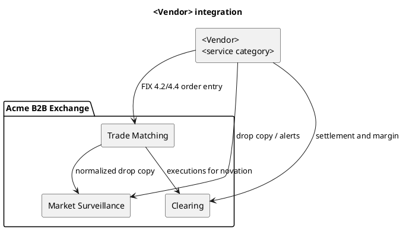

# PlantUML Architecture Generator

Given a vendor integration idea, emit one PlantUML document. Map it onto Acme's three modules. Do not invent a fourth Acme system.

Modules:

- Trade Matching: high-throughput price-time matching. Vendors stay off the critical path. Arrow label is FIX order entry only when the idea touches matching.
- Market Surveillance: normalized drop copy and alerts. Arrow only when the idea touches surveillance. Do not put the vendor on the matching latency path.
- Clearing: novation, margin, and settlement. Arrow only when the idea touches clearing.

Always draw the internal Acme flows: matching to surveillance as drop copy, and matching to clearing as executions.

Replace the placeholders below. Use `adapter required` when the idea has no FIX support.

Delete any `Vendor -->` line whose module the idea does not touch. Keep both internal Acme arrows.
